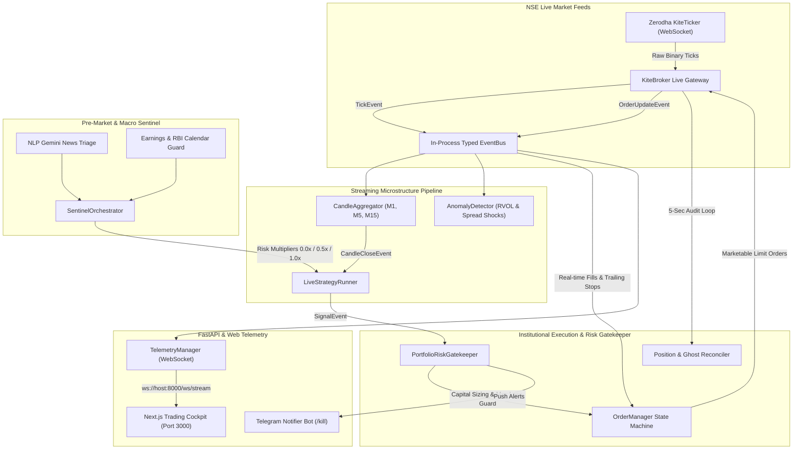

# ⚡ Trillionaire — Institutional MIS Intraday Algorithmic Engine

**Trillionaire** is a production-grade, event-driven quantitative algorithmic trading monorepo targeting **Zerodha Kite Connect** for automated intraday (**MIS**) execution across liquid NSE NIFTY 50 equities and index derivatives.

Built with strict SEBI regulatory compliance, institutional risk guardrails, real-time reactive streaming, pre-market AI shock guards, and a Bloomberg/TradingView dark-mode visual telemetry cockpit.

---

## 🏛️ System Architecture



---

## 📂 Monorepo Structure

```
Trillionaire/
├── config/                     # Runtime settings, capital tiers, and sector maps
│   ├── settings.py             # Pydantic-settings environment parser
│   ├── capital_tiers.yaml      # Tier 0 to Tier 3 capital, risk & drawdown bounds
│   └── sector_map.yaml         # Top 25 NSE NIFTY 50 stock-to-sector mappings
├── shared/                     # Domain kernel (Pydantic v2 schemas, enums, constants)
│   ├── schemas.py              # Tick, Candle, Signal, Order, Position, StockProfile
│   ├── enums.py                # TradingMode, ClusterRegime, SentinelStatus, Side
│   ├── constants.py            # IST timings, statutory tax rates, Redis keys
│   └── exceptions.py           # Domain risk and execution exception hierarchy
├── research_lab/               # Historical analytics, regime profiling & backtesting
│   ├── data_loader/            # Kite Connect historical 5-yr data ingestion
│   ├── profiler/               # K-Means clustering, ADR%, beta, and Zerodha charges
│   ├── backtester/             # Zero look-ahead vectorized & event-driven backtester
│   └── artifacts/              # stock_profiles.json, backtest reports, equity curves
├── sentinel/                   # Pre-trade shock guards & macro event filters
│   ├── news_triage/            # Gemini NLP news sentiment classification
│   ├── calendar_guard/         # RBI policy, Budget, US Fed, earnings blackouts
│   └── orchestrator.py         # Daily risk tag generator (0.0x, 0.5x, 1.0x)
├── trading_engine/             # Live execution runtime & async event loop
│   ├── core/                   # TrillionaireEngine coordinator & typed EventBus
│   ├── data/                   # Streaming CandleAggregator, RVOL AnomalyDetector
│   ├── strategy/               # Dual-Confirmation VWAP + CPR + Sector Trend Runner
│   ├── risk/                   # Dynamic position sizer, MTM circuit breakers, profit-lock
│   ├── execution/              # SEBI marketable limit router, 1R trailing stop, paper broker
│   └── brokers/kite/           # Production KiteTicker WS, headless TOTP auth, reconciler
├── api_bridge/                 # FastAPI REST and WebSocket telemetry gateway
│   ├── routes/                 # Telemetry & mutating control endpoints (/control/kill-switch)
│   ├── ws/                     # Real-time WebSocket broadcasting with SNAPSHOT hydration
│   └── main.py                 # ASGI application entrypoint
├── web_dashboard/              # Next.js 14 Institutional Trading Cockpit
│   ├── src/app/                # Dark-mode dashboard layout & real-time telemetry view
│   ├── src/components/         # TradingView charts, Watchlist matrix, Orders/Positions
│   └── src/hooks/              # useTrillionaireStream reactive WebSocket hook
├── deploy/                     # Mumbai AWS VPS production deployment stack
│   ├── Dockerfile.engine       # Slim Python 3.11 container with IST timezone
│   ├── Dockerfile.dashboard    # Multi-stage standalone Next.js Alpine container
│   ├── docker-compose.prod.yml # Production Redis AOF + Engine + Dashboard + Nginx
│   ├── nginx/                  # Nginx reverse proxy & WebSocket upgrade config
│   ├── systemd/                # Systemd service unit for 24/7 host daemon
│   └── scripts/                # VPS bootstrap script for AWS Lightsail ap-south-1
├── scripts/                    # Automation scripts
│   ├── init_dev.ps1            # Developer environment bootstrap
│   └── start_local.ps1         # Windows local launcher (FastAPI + Next.js Cockpit)
└── tests/                      # 100% passing test suite
    ├── unit/                   # 57 unit tests across all engine modules
    └── integration/            # End-to-end replay, crash recovery & kill-switch tests
```

---

## 🚀 Local Quickstart (Windows Development & Replay)

### 1. Prerequisites
- Python 3.11+
- Node.js 20+ & npm
- Git

### 2. Environment Setup
```powershell
# Run the automated environment initialization script
.\scripts\init_dev.ps1
```

### 3. Launch Local Platform
Run the single unified PowerShell launcher:
```powershell
.\scripts\start_local.ps1
```
This automatically:
- Validates root `.env` and `web_dashboard/.env.local`
- Verifies `research_lab/artifacts/stock_profiles.json` (runs profiler if absent)
- Starts the FastAPI Telemetry Bridge on port `8000`
- Starts the Next.js Visual Trading Cockpit on port `3000`

### 4. Interactive URLs
- **Visual Trading Cockpit:** [http://localhost:3000](http://localhost:3000)
- **FastAPI Interactive Docs:** [http://localhost:8000/docs](http://localhost:8000/docs)
- **WebSocket Telemetry Stream:** `ws://localhost:8000/ws/stream`

---

## 🧪 Research Lab & Quantitative Calibration

### 1. Ingest Historical Data
Download 5 years of 1-minute and 5-minute historical OHLCV data from Zerodha Kite Connect:
```bash
python -m research_lab.data_loader.historical_ingestion
```

### 2. Calibrate Universe Microstructure Profiles
Computes 5-year beta against NIFTY 50, 20-day Average Daily Range (ADR%), intraday VWAP/CPR distribution, and K-Means cluster regimes:
```bash
python -m research_lab.profiler.stock_profiler
```
*Output Artifact:* `research_lab/artifacts/stock_profiles.json`

### 3. Run Walk-Forward Event-Driven Backtest
Evaluates out-of-sample Sharpe Ratio, Profit Factor, Max Drawdown, and exact Zerodha statutory MIS charges:
```bash
python -m research_lab.backtester.engine
```

---

## 🛡️ Pre-Market Sentinel Safeguards

Every morning at **08:30–08:45 AM IST**, the engine boots the Sentinel module:
1. **Earnings & Macro Blackout Guard (`sentinel/calendar_guard/`):**
   - Blocks stock on Quarterly Earnings Results date (`DO_NOT_TRADE`).
   - Halves risk size (`CAUTION_HALF_SIZE` / `0.5x`) on RBI MPC Rate Decisions, Union Budget, and US Fed FOMC days.
2. **AI News Triage (`sentinel/news_triage/`):**
   - Fetches overnight news headlines from Indian financial media.
   - Leverages Gemini NLP to score sentiment and identify severe idiosyncratic shocks (ED/CBI raids, promoter pledges, regulatory bans).
   - Generates persistent manifest: `sentinel/artifacts/daily_sentinel_tags.json`.

---

## ⚙️ Live Trading & Institutional Risk Management

### Strict SEBI Retail Execution Rules:
- **Marketable Limit Orders Only:** Never places raw MARKET orders. Buys are priced at `LTP * 1.001` and Sells at `LTP * 0.999` to eliminate market-order slippage while guaranteeing immediate queue fills.
- **Retail Rate Limiter:** Strictly enforced $\le 10$ orders per sliding 1-second window.
- **Tick-Size Rounding:** All limit and trigger prices are rounded to exact NSE tick sizes (typically Rs. 0.05).
- **Session Timing Enforcement:**
  - **09:15 – 09:25 IST:** Calibration buffer (No trade entries permitted).
  - **09:25 – 14:30 IST:** Active dual-confirmation entry window.
  - **14:30 – 15:10 IST:** No new entries permitted.
  - **15:10 IST:** Mandatory force square-off of all open intraday MIS positions.

### Multi-Tier Risk Guardrails (`PortfolioRiskGatekeeper`):
1. **Daily Circuit Breaker:** Hard shutdown if cumulative intraday loss reaches **-1.5%** of capital.
2. **Profit-Locking Trailing Floor:** If intraday MTM reaches **+1.2%**, a trailing floor locks in at **+0.6%**. If profit retraces to +0.6%, all positions are flattened and trading is locked for the day.
3. **1R Breakeven Trailing Stop:** When an active position advances $+1R$ into profit, its stop loss is automatically ratcheted to the average entry price.

---

## ☁️ Production Mumbai VPS Deployment (AWS Lightsail)

Deploying to AWS Lightsail Mumbai (`ap-south-1`) ensures low-latency (<5ms) connectivity to Zerodha's hosting infrastructure.

### Step 1: Provision Lightsail VPS
1. Launch an Ubuntu 22.04 or 24.04 LTS instance in region `ap-south-1` (Mumbai).
2. Attach an **AWS Static IP** to the instance.

### Step 2: Zerodha Kite Connect IP Whitelisting
1. Log in to [Zerodha Developer Console](https://developers.kite.trade/apps).
2. Open your trading app and add the Lightsail VPS Static IP to the **Static IP Whitelist**.
3. Set the Redirect URL to: `https://your-domain.com/api/v1/auth/callback` (or your static IP).

### Step 3: Run VPS Bootstrap Script
SSH into your Lightsail instance and run:
```bash
curl -fsSL https://raw.githubusercontent.com/sureshgmendon/Trillionaire/main/deploy/scripts/setup_ubuntu_vps.sh | sudo bash
```
This script automatically:
- Synchronizes timezone strictly to `Asia/Kolkata` (IST)
- Installs Docker CE and Docker Compose Plugin
- Configures UFW firewall (allows 22, 80, 443; blocks public exposure of internal ports 8000, 3000, 6379)
- Installs systemd service `/etc/systemd/system/trillionaire.service`

### Step 4: Clone & Configure
```bash
cd /opt/trillionaire
git clone https://github.com/sureshgmendon/Trillionaire.git .

# Configure production environment secrets
cp .env.example .env
nano .env

# Configure frontend environment
cp web_dashboard/.env.local.example web_dashboard/.env.local
nano web_dashboard/.env.local
```

### Step 5: Start Production Daemon
```bash
sudo systemctl enable --now trillionaire.service

# Inspect live production journal logs
sudo journalctl -u trillionaire -f
```

---

## 📈 Capital Scaling Framework

Configured in `config/capital_tiers.yaml`:

| Tier | Capital | Max Risk/Trade | Max Positions | Max Leverage | Target Strategy |
| :--- | :--- | :--- | :--- | :--- | :--- |
| **`PAPER`** | Virtual | 0.5% | 3 | 3.0x | Simulation & Strategy Validation |
| **`TIER_1_MICRO`** | ₹1,00,000 | 0.5% (₹500) | 2 | 2.5x | Production Calibration (Top 5 Stocks) |
| **`TIER_2_GROWTH`** | ₹5,00,000 | 0.5% (₹2,500) | 3 | 3.0x | Multi-Sector Trend & Mean Reversion |
| **`TIER_3_SCALE`** | ₹10,00,000 | 0.5% (₹5,000) | 4 | 3.5x | Full Universe (25 Stocks + Index Duals) |

---

## 🚨 Emergency Operator Runbook

In volatile market conditions, rapid liquidity drops, or unexpected black swans, operators have 4 independent layers of emergency shutdown:

### Layer 1: Visual Cockpit Emergency Kill Button
- Click the red **KILL SWITCH** button located on the top telemetry bar of the Next.js Cockpit.
- Instantly flattens all open positions and engages the engine lockout.

### Layer 2: Authenticated REST API
```bash
curl -X POST "http://localhost:8000/api/v1/control/kill-switch?reason=OPERATOR_PANIC" \
     -H "X-API-Key: YOUR_TRILLIONAIRE_ADMIN_KEY"
```

### Layer 3: Telegram Remote Command
Send `/kill` in your authorized Telegram chat.
The `TelegramNotifier` verifies the chat ID, executes `engine.emergency_flatten()`, and replies with confirmation of all liquidated positions.

### Layer 4: Emergency Docker Shutdown
If host OS or network degrades:
```bash
cd /opt/trillionaire/deploy
docker compose -f docker-compose.prod.yml down
```

---

## ✅ Test Suite & Verification

The engine is validated with 60 comprehensive unit and integration tests covering:
- Zero look-ahead technical indicators (VWAP, CPR, Wilder ATR, RVOL)
- SEBI rate limiting ($\le 10$ orders/sec) and marketable limit pricing
- Automated headless TOTP Kite Connect authentication
- Full Replay-to-Dashboard event pipeline
- Crash-restart broker position and bracket hydration
- Emergency kill-switch cascade

```powershell
python -m pytest tests -v
```

```
============================== test session starts ==============================
collected 60 items

tests/integration/test_e2e_lifecycle_and_recovery.py ...                  [  5%]
tests/unit/test_api_bridge_and_telegram.py .......                        [ 16%]
tests/unit/test_backtester.py .......                                     [ 28%]
tests/unit/test_event_bus_and_streaming.py ....                           [ 35%]
tests/unit/test_kite_adapter_and_engine.py ........                       [ 48%]
tests/unit/test_profiler_and_charges.py ......                            [ 58%]
tests/unit/test_risk_and_execution.py .........                           [ 73%]
tests/unit/test_schemas_and_config.py ............                        [ 93%]
tests/unit/test_sentinel.py ....                                          [100%]

======================== 60 passed, 1 warning in 2.63s ==========================
```

---

## 📜 License & Compliance
This software is built strictly for proprietary algorithmic quantitative execution. Ensure all live broker credentials and TOTP secrets are held securely in compliance with NSE and SEBI retail algorithmic guidelines.
